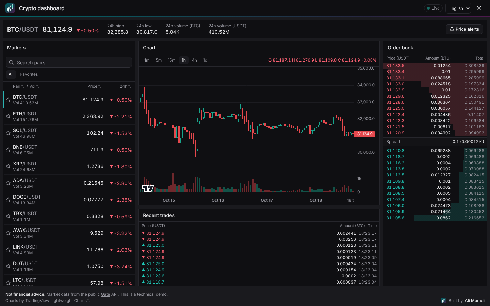
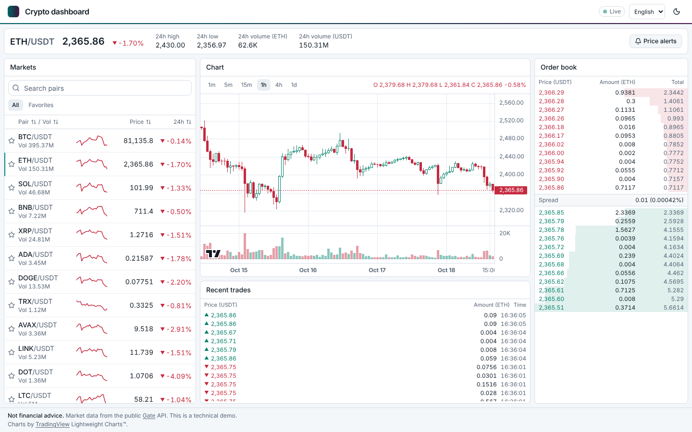
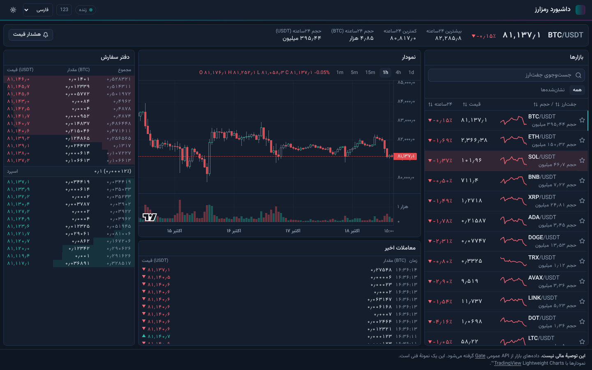
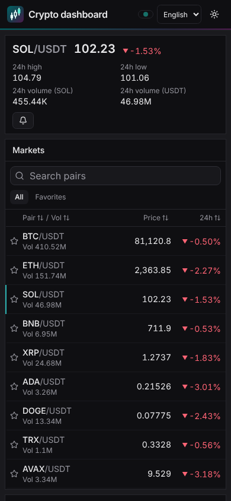

# Crypto dashboard

Built by [Ali Moradi](https://ali-moradi-develop.com).

A live crypto market dashboard: real-time prices for 20 pairs, candlestick
charts, order book, recent trades and price alerts, in English, Turkish and
Persian (right-to-left). Market data comes from Gate's public API, straight
from the browser: no server, no database, no login.



> **Not financial advice.** This project is a technical demo.

## What it shows

- **Live data, smooth UI.** The exchange sends dozens of WebSocket messages per
  second. Messages are buffered and applied at most once per animation frame,
  market data lives in a Redux store outside the components, and each row
  subscribes only to its own pair. A price change in BTC re-renders the BTC row,
  nothing else; the chart streams with zero React renders. Unit tests count
  renders to keep it that way.
- **Adapter pattern.** The app depends on a small `MarketDataSource` interface,
  not on the exchange. Gate is one implementation (`src/shared/api/gate`);
  adding another exchange means adding another adapter.
- **Connection health.** Reconnect with exponential backoff and jitter, heartbeat
  pings, resubscribe and refetch after a reconnect, a "data is stale" warning,
  and the socket closes while the tab is hidden.
- **Testing without the network.** Vitest unit tests use a fake WebSocket and a
  fake data source; Playwright E2E tests run against a mocked Gate (REST and
  WebSocket), on desktop and mobile, with an axe accessibility scan. CI never
  talks to the exchange.
- **Internationalization.** English, Turkish and Persian; locale in the URL;
  Persian is right-to-left with Persian digits (switchable to Latin) and the
  Gregorian calendar; numbers and dates through `Intl`.
- **Accessibility.** Up/down is never color alone (arrows, hollow vs filled
  candles), colors pass contrast and color-vision-deficiency checks, keyboard
  and screen-reader friendly controls.

| Light theme                                        | Persian, right-to-left                           | Phone                                 |
| -------------------------------------------------- | ------------------------------------------------ | ------------------------------------- |
|  |  |  |

## Features

- Market table: 20 USDT pairs with live price flash, 24h change, volume and
  sparkline; sort, search and favorites (saved in the browser).
- Candlestick chart with volume, intervals from 1 minute to 1 day.
- Order book with depth bars, best bid/ask and spread.
- Recent trades, live.
- Pair header: last price, 24h high, low and volume.
- Price alerts with browser notifications (stored locally).
- Dark and light themes.

## Stack

Vite, React 19 with React Compiler, TypeScript (strict), Redux Toolkit, React
Router, react-i18next, Tailwind CSS and shadcn/ui, TradingView Lightweight
Charts, Vitest, Playwright, ESLint and Prettier, GitHub Actions. Code follows
Feature-Sliced Design. Details and reasons: [docs/architecture.md](docs/architecture.md).
Scope: [docs/brief.md](docs/brief.md).

## Getting started

Requirements: Node.js 24 or newer, pnpm 12.

```sh
pnpm install
pnpm dev            # http://localhost:5173
```

| Command             | What it does                   |
| ------------------- | ------------------------------ |
| `pnpm build`        | production build into `dist/`  |
| `pnpm preview`      | serve the production build     |
| `pnpm typecheck`    | type check (TypeScript 7)      |
| `pnpm lint`         | ESLint                         |
| `pnpm format:check` | Prettier                       |
| `pnpm test`         | unit tests                     |
| `pnpm test:e2e`     | end-to-end tests (mocked Gate) |

Exchange hosts can be changed at build time with `VITE_GATE_REST_URL` and
`VITE_GATE_WS_URL`.

## Credits

- Market data: [Gate](https://www.gate.com) public API.
- Charts: [TradingView Lightweight Charts™](https://www.tradingview.com/lightweight-charts/)
  by TradingView, Inc. (Apache 2.0), with the TradingView attribution shown in the
  app.
